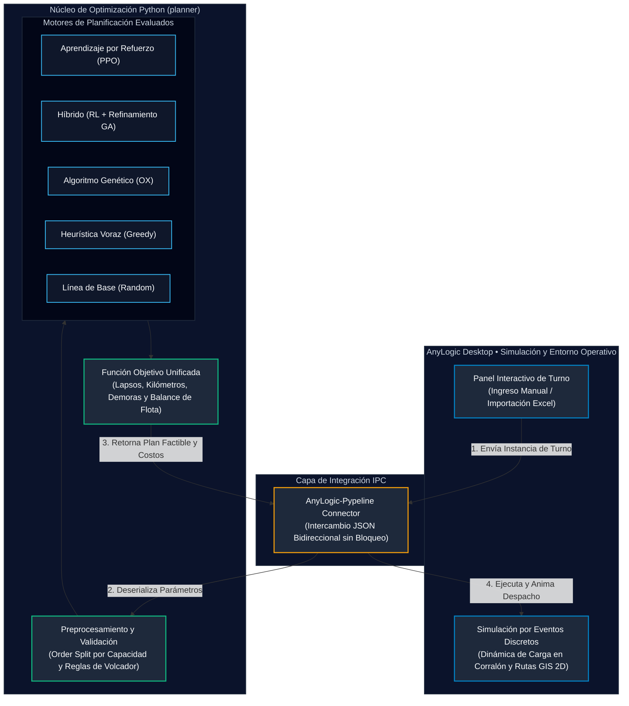

<h1 align="center">Pedemonte Digital Twin</h1>

<p align="center">
  <strong>Gemelo digital logístico para planificación y simulación operativa de despacho</strong><br>
  Optimización combinatorial de rutas, asignación de flota y seguimiento interactivo en entorno GIS.
</p>

<p align="center">
  
  
  
  
</p>

<p align="center">
  <a href="docs/README.md">Documentación Técnica</a> •
  <a href="docs/getting-started.md">Guía de Instalación</a> •
  <a href="docs/user-manual.md">Manual de Operación</a> •
  <a href="docs/system-design.md">Diseño de Arquitectura</a> •
  <a href="docs/quality-and-experiments.md">Calidad y Experimentos</a>
</p>

---

## Descripción del Proyecto

Pedemonte Digital Twin es una solución de gemelo digital aplicada a la operación logística real de **Pedemonte Materiales**, una empresa comercializadora de materiales de construcción ubicada en **Granadero Baigorria (Santa Fe, Argentina)**.

La empresa gestiona las entregas diarias a obras y clientes finales mediante una flota acotada de **dos camiones de reparto**. El propósito central de este desarrollo es resolver la asignación y secuenciamiento de viajes por turno, evaluando experimentalmente **qué algoritmo de optimización resulta más eficiente** frente a las demandas y restricciones operativas reales del negocio.

### Restricciones Operativas y Reglas de Negocio
- **Capacidad de Carga y Flota**: La empresa cuenta con 2 camiones de 8 unidades de capacidad nominal cada uno. Los pedidos que exceden la capacidad vehicular son divididos automáticamente (*order split*) en entregas coordinadas.
- **Mecanismo de Descarga por Volcador**: Los camiones no poseen tolvas ni mixers giratorios; disponen de una caja trasera basculante con **pistones hidráulicos (volcador)** para arrojar materiales a granel (arena, piedra, grava) por gravedad. Debido a que accionar los pistones vuelca toda la carga trasera, los pedidos con descarga por volcador **no pueden preceder a pedidos estándar o paletizados**. Deben descargarse en último término o en viajes dedicados exclusivos.
- **Ventanas Horarias y Turnos**: La operativa se organiza en dos turnos diarios (mañana y tarde) con una tolerancia de finalización de 15 minutos. Todo retraso sobre el horario comprometido genera sobrecostos por penalización de servicio.
- **Concurrencia de Recursos en Corralón**: Los camiones comparten la misma infraestructura de carga física (palas cargadoras y operarios), lo que impide inicios simultáneos de viaje si los recursos están ocupados.

### Rol de AnyLogic y Justificación del Entorno de RL
Para incorporar **Aprendizaje por Refuerzo Profundo (RL)** en la planificación de turnos, resultaba indispensable contar con un simulador representativo. Otras alternativas teóricas fueron desestimadas por razones técnicas y operativas:
1. **Entrenamiento en la Operación Viva (Planta Real)**: Inviable en la práctica. Durante la fase de exploración estocástica, un agente de RL comete miles de decisiones subóptimas. Probar una política no entrenada en la calle generaría incumplimientos severos de turnos, clientes desatendidos, parálisis operativa y desperdicio de combustible.
2. **Modelos Matemáticos y Heurísticos Estáticos**: Aunque computacionalmente livianos, ignoran la dinámica temporal y la concurrencia: no modelan las colas de espera en las palas mecánicas, la variabilidad de tiempos de descarga ni la interacción de eventos discretos.
3. **Simuladores de Dinámica Continua 3D (e.g. Isaac Gym, CARLA)**: Inconvenientes por consumo de cómputo innecesario. La complejidad del problema no radica en la física del neumático o el frenado milimétrico, sino en la logística de colas, eventos y restricciones operativas.

**AnyLogic** proporciona el equilibrio óptimo al integrar simulación de eventos discretos (recursos y tolva de carga del corralón), modelado basado en agentes (comportamiento de los camiones) y un entorno GIS real a escala urbana (1:10000) con tiempos de viaje basados en OpenStreetMap/OSRM. Esto permite entrenar políticas de RL de forma segura y comparar su rendimiento en igualdad de condiciones frente a algoritmos genéticos y heurísticas clásicas.

---

## Arquitectura del Sistema

La solución desacopla la capa de simulación y visualización (AnyLogic) del núcleo de decisión y optimización matemática (Python), comunicándose mediante un protocolo IPC de transferencia de estructuras de datos en formato JSON.



---

## Motores de Planificación

Todos los planificadores implementan el contrato `planner.core.base.PlanificadorTurno` y son evaluados contra la misma función de costo global multicriterio:

| Algoritmo | Módulo | Tipo de Enfoque | Propósito Operativo |
| :--- | :--- | :--- | :--- |
| **Aprendizaje por Refuerzo** | `planner.rl.policy_planner` | Aprendizaje profundo (PPO) | Propuesta central. Inferencia subsegundo basada en políticas entrenadas en simulación. |
| **Híbrido (RL → GA)** | `planner.algorithms.hybrid_rl_ga` | Sembrado guiado + Metaheurística | Inicia la población del GA con la solución generada por RL y ejecuta refinamiento evolutivo. |
| **Algoritmo Genético** | `planner.algorithms.ga` | Metaheurística poblacional | Exploración global sobre espacio de permutaciones con operador de cruce Order Crossover (OX). |
| **Heurística Voraz** | `planner.algorithms.greedy` | Constructivo determinista | Asignación voraz basada en urgencia de ventana horaria, distancia y segregación de volcador. |
| **Línea de Base Aleatoria** | `planner.algorithms.random_feasible` | Muestreo estocástico | Cota inferior de contraste. Genera soluciones factibles respetando restricciones duras. |

> [!NOTE]
> Las políticas de Aprendizaje por Refuerzo (`rl_policy.zip`, `rl_policy_v1.zip`, `rl_policy_v2.zip`) se encuentran preentrenadas y versionadas en `python/models/rl/`. No es necesario ejecutar etapas de reentrenamiento para operar el sistema.

---

## Estructura del Repositorio

```text
PedemonteDigitalTwin_v2/
├── anylogic/
│   └── PedemonteDigitalTwin_v2/      # Modelo AnyLogic (.alp), caché y assets web
├── docs/                             # Documentación técnica, manuales y plantillas
│   └── pdoc_template/                # Plantilla personalizada de documentación pdoc
├── python/
│   ├── anylogic_export/              # Directorio para exportación de modelos Alpyne
│   ├── data/                         # Conjuntos de datos, caché vial y coordenadas
│   ├── models/                       # Políticas preentrenadas de RL (.zip y metadatos)
│   ├── planner/                      # Núcleo de planificación y optimización
│   │   ├── algorithms/               # Implementación de algoritmos (GA, Greedy, RL, Random)
│   │   ├── core/                     # Esquemas, configuración y protocolos base
│   │   ├── domain/                   # Validación de restricciones y preprocesamiento
│   │   ├── integration/              # Códecs de serialización y puentes con AnyLogic
│   │   ├── rl/                       # Entornos Gymnasium, generadores y runtime de RL
│   │   └── routing/                  # Decodificador de rutas, caché vial y función objetivo
│   ├── scripts/                      # Pipelines de demanda, OCR, geocoding y simulación
│   └── tests/                        # Suite integral de pruebas automatizadas
├── .github/workflows/                # Pipelines de CI y despliegue de documentación
└── pyproject.toml                    # Configuración central de calidad de código (Ruff)
```

---

## Instalación y Configuración

### 1. Entorno Python

Requisitos: **Python 3.11** y PowerShell / Bash.

```powershell
# Crear y activar entorno virtual
py -3.11 -m venv .venv
.\.venv\Scripts\Activate.ps1

# Actualizar gestor de paquetes e instalar dependencias
python -m pip install --upgrade pip
python -m pip install -r .\python\requirements.txt
```

### 2. Verificación de la Suite de Pruebas

Para comprobar la integridad del sistema y las 174 pruebas unitarias e integrales:

```powershell
.\.venv\Scripts\python -m pytest python/tests -q --tb=short
```

---

## Configuración de AnyLogic

Para vincular el modelo de simulación con el entorno Python:

1. **Descargar las librerías requeridas**:
   - [AnyLogic-Pypeline](https://github.com/the-anylogic-company/AnyLogic-Pypeline/releases): Conector bidireccional entre AnyLogic y procesos Python.
   - [AnyLogicWebToolkit](https://github.com/NiconiKimg/AnyLogicWebToolkit): Librería de componentes web desarrollada para el proyecto.
2. **Importar librerías en AnyLogic**:
   - En AnyLogic, abrir la vista *Palette* $\rightarrow$ botón *Manage Libraries* $\rightarrow$ *Add* e incorporar los archivos `.jar` descargados.
3. **Abrir el modelo del proyecto**:
   - Abrir el archivo `anylogic/PedemonteDigitalTwin_v2/PedemonteDigitalTwin_v2.alp`.
4. **Configurar la ruta del entorno virtual**:
   - En el agente `Main`, seleccionar el objeto `pyCommunicator`.
   - Modificar la propiedad `pythonExecPath` asignando la ruta absoluta al ejecutable de Python de su entorno virtual, por ejemplo:
     ```text
     C:\ruta\al\proyecto\PedemonteDigitalTwin_v2\.venv\Scripts\python.exe
     ```
5. **Simulación Headless y Benchmarks con Alpyne (Opcional)**:
   - Para ejecutar comparativas masivas mediante scripts de Python (`python/scripts/simulation/run_simulated_comparison.py`), exportar el experimento de Alpyne desde AnyLogic con destino a:
     ```text
     python/anylogic_export/simulated_comparison/PedemonteDigitalTwin_v2.zip
     ```
6. **Ejecutar la Simulación**:
   - Compilar el modelo (*Build Model*) y presionar *Run*. Desde la interfaz es posible ingresar pedidos manualmente o cargarlos vía Excel, seleccionar el algoritmo deseado y presionar **Generar y ejecutar plan**.

---

## Documentación del Sistema

Para consultar detalles técnicos adicionales, el repositorio cuenta con las siguientes guías:

- **[Primeros Pasos](docs/getting-started.md)**: Instrucciones detalladas de despliegue inicial y resolución de problemas frecuentes.
- **[Manual de Operación](docs/user-manual.md)**: Guía de uso del panel de control, formatos de planillas Excel y lectura de indicadores clave.
- **[Diseño del Sistema](docs/system-design.md)**: Fundamentos matemáticos, formulación del problema y arquitectura de agentes.
- **[Calidad y Experimentos](docs/quality-and-experiments.md)**: Procedimiento de evaluación experimental, reproducibilidad y métricas.
- **[Desarrollo y Despliegue](docs/development-and-deployment.md)**: Historial de decisiones técnicas, estándares y líneas de trabajo futuro.

---

## Integrantes

| Avatar | Nombre Completo | Perfil de GitHub |
| :---: | :--- | :---: |
|  | Carlos Ricardo Gugliermino Zuñiga | [](https://github.com/carlex74) |
|  | Nicolás Pedemonte | [](https://github.com/NiconiKImg) |
|  | Luca Trincavelli | [](https://github.com/LucaTvl) |
|  | Franco Zariaga | [](https://github.com/Frasquito3) |
