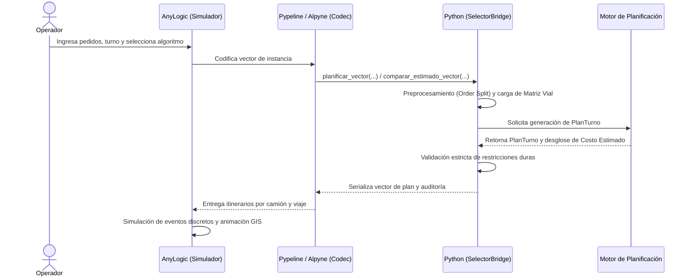

<div align="center">

# Diseño del Sistema y Arquitectura

[Inicio](../README.md) •
[Documentación](README.md) •
[Primeros Pasos](getting-started.md) •
**Diseño del Sistema** •
[Manual de Operación](user-manual.md) •
[Calidad y Experimentos](quality-and-experiments.md) •
[Desarrollo y Despliegue](development-and-deployment.md)

</div>

---

**Pedemonte Digital Twin** desacopla la simulación de eventos discretos y la interfaz geográfica interactiva (AnyLogic) del motor de optimización combinatoria y aprendizaje por refuerzo (Python). Esta arquitectura modular permite validar matemáticamente los algoritmos en aislamiento, ejecutar pruebas automatizadas en segundos y garantizar que todos los métodos de planificación compitan bajo las mismas reglas de dominio.

<a id="arquitectura-general"></a>
## Arquitectura General



### División de Responsabilidades

| Capa de Simulación y Visualización (AnyLogic) | Núcleo de Planificación y Datos (Python) |
| :--- | :--- |
| • Interfaz de usuario de operación, comparación y carga web de pedidos (`web/pedidos`)<br>• Simulación de eventos discretos en corralón (concurrencia de operarios, palas y proveedores)<br>• Dinámica vehicular sobre red GIS (escala 1:10000) y vista 3D<br>• Cómputo de métricas operativas simuladas al cierre del turno | • Preprocesamiento de demanda y partición automática de pedidos (*order split*)<br>• Motores de optimización: `RL`, `HIBRIDO`, `GA`, `GREEDY` y `RANDOM`<br>• Decodificador de rutas, regla de descarga por volcador y validador de factibilidad<br>• Función objetivo multicriterio unificada y caché vial estricta (`cache_vial.csv`)<br>• Pipeline de OCR con Gemini, geocodificación OSM y generación estocástica de turnos |

---

<a id="algoritmos-de-planificacion"></a>
## Algoritmos de Planificación

Todos los optimizadores implementan el protocolo `planner.core.base.PlanificadorTurno` y operan sobre la misma representación de instancia (`InstanciaTurno`) y matriz de viaje (`MatrizViaje`).

### 1. Aprendizaje por Refuerzo (`RL`) y Simulación con AnyLogic
Constituye la propuesta metodológica central del proyecto (`planner.rl.policy_planner` y `planner.rl.policy_runtime`):
- **Arquitectura de política:** Red neuronal entrenada mediante **MaskablePPO** (`sb3-contrib`) sobre un entorno Gymnasium (`planner.rl.policy_env`) con representación vectorial fija de hasta **35 slots de tareas** (`max_pedidos_rl_validado = 35`).
- **Máscara temporal dura (`usar_mascara_temporal_dura = True`):** Impide en tiempo de inferencia y entrenamiento seleccionar acciones que violen la capacidad remanente del camión (8 unidades), la precedencia de descarga por volcador o las ventanas horarias de los clientes.
- **Ordenamiento canónico y multi-rollout:** Los pedidos se normalizan canónicamente (`ordenar_slots_canonicamente = True`) y el planificador evalúa `num_rollouts = 24` trayectorias para seleccionar aquella de menor costo estimado factible.

#### Cómo se Entrena la Política con AnyLogic (Alpyne)

El gemelo digital en AnyLogic actúa como el entorno de evaluación física de la política. Para conectar AnyLogic con Python de forma desacoplada y sin interfaz gráfica durante entrenamientos masivos, el modelo exporta un experimento de Reinforcement Learning denominado `AlpyneExperiment` (`PedemonteDigitalTwin_v2.alp`):

1. **Configuración del Experimento (Java en AnyLogic):**
   Al inicializarse cada réplica, AnyLogic recibe los parámetros del turno y configura el entorno en modo evaluación:
   ```java
   root.MODO_EJECUCION = ModoEjecucion.RL_EVALUATION;
   root.PROVEEDORES_HABILITADOS = proveedoresHabilitados;
   System.setProperty("webtoolkit.enabled", "false");

   String rutaPythonConfigurada = rutaPythonProyectoPypeline == null ? "" : rutaPythonProyectoPypeline.trim();
   if (!rutaPythonConfigurada.isEmpty()) {
       System.setProperty("pedemonte.python.root", rutaPythonConfigurada);
   }
   root.rutaPythonProyectoPypeline = rutaPythonConfigurada;
   root.alpyneSeedEjecucion = seedEjecucion;
   root.alpyneSeedEscenario = seedEscenario;
   root.alpyneInstanciaVector = instanciaVector == null ? new double[0] : instanciaVector.clone();
   root.alpyneInstanciaId = instanciaId == null ? "" : instanciaId.trim();
   root.alpyneFechaOperacion = fechaOperacion == null ? "" : fechaOperacion.trim();
   root.alpyneIdentificadoresPedidos = identificadoresPedidos == null ? "" : identificadoresPedidos.trim();
   ```

2. **Recepción y Ejecución del Plan:**
   Python despacha el plan generado hacia AnyLogic mediante el método de acción:
   ```java
   root.alpynePlanVector = planVector == null ? new double[0] : planVector.clone();
   root.procesarAccionAlpyne(accionCodigo);
   ```
   Donde `procesarAccionAlpyne` activa la simulación física de los dos camiones sobre la red vial real:
   ```java
   alpyneAccionRecibida = true;
   alpyneAccionCodigo = accionCodigo;
   alpyneError = false;
   alpyneInstanciaAceptada = false;
   eventoDecisionAlpyne.restart(0.0);
   ```

3. **Condición de Parada:**
   La simulación concluye cuando se completan todos los viajes programados o se detecta una inconsistencia operativa:
   ```java
   return alpyneError || ejecucionFinalizada;
   ```

4. **Retorno de Métricas Reales:**
   AnyLogic devuelve a Python las observaciones y costos operativos finales (`costoTotalAlpyne()`, `tardanzaTotalMin`, `diferenciaFinCamionesMin`, ocupación y demoras en corralón) para auditar el desempeño de la política frente a los métodos clásicos.

El control de este ciclo desde Python se implementa en `planner.integration.simulated_execution` (`ejecutar_plan_en_modelo_exportado`) mediante la API de Alpyne (`AnyLogicModel.reset()` $\rightarrow$ `take_action()` $\rightarrow$ `get_observation()`).

### 2. Refinamiento Híbrido (`HIBRIDO`: RL $\rightarrow$ GA)
Implementado en `planner.algorithms.hybrid_rl_ga`, combina la velocidad de construcción de la política neuronal con la búsqueda local evolutiva:
1. Obtiene la secuencia inicial factible generada por la política `RL`.
2. Inyecta dicha secuencia como individuo semilla en la población inicial del Algoritmo Genético (`GA`).
3. Ejecuta las generaciones evolutivas con operadores de cruce Order Crossover (OX), mutación por intercambio (*swap*) e inversión de subsegmentos.
4. Aplica un criterio de **no inferioridad garantizada**: si el plan evolucionado por `GA` no supera el costo de la semilla `RL`, el método retiene automáticamente la solución original de `RL`.

### 3. Motores de Referencia (Baselines)
- **Heurística Voraz (`GREEDY` — `planner.algorithms.greedy`):** Algoritmo constructivo determinista que asigna iterativamente la tarea factible de menor costo incremental, priorizando urgencia de ventana horaria, proximidad geográfica y compatibilidad de volcador.
- **Algoritmo Genético Puro (`GA` — `planner.algorithms.ga`):** Metaheurística poblacional que parte de permutaciones iniciales sin asistencia de la política RL, permitiendo cuantificar el aporte específico del *warm-start* neuronal en el modo Híbrido.
- **Línea de Base Aleatoria (`RANDOM` — `planner.algorithms.random_feasible`):** Construye planes factibles mediante muestreo estocástico controlado por semilla, estableciendo la cota inferior de desempeño admisible.

---

<a id="funcion-objetivo-compartida"></a>
## Función Objetivo Compartida y Modelo Operativo

Independientemente del algoritmo utilizado, todo `PlanTurno` es evaluado mediante una única función objetivo determinista definida en `planner.routing.objective` (`VERSION_AUDITORIA_COSTO = "estimacion-costo-v3"`) y parametrizada en `ConfiguracionPlanificacion`:

| Componente de Costo / Penalización | Atributo en `ConfiguracionPlanificacion` | Ponderación |
| :--- | :--- | :--- |
| Tarea operativa no entregada | `costo_tarea_no_entregada` | `10000.0` |
| Pedido original incompleto (partes faltantes) | `costo_pedido_original_incompleto` | `5000.0` |
| Minuto de exceso sobre la tolerancia del turno | `costo_por_min_exceso_tolerancia` | `500.0` |
| Minuto de tardanza respecto a ventana de cliente | `costo_por_min_tardanza` | `100.0` |
| Inicio de viaje desde el corralón | `costo_por_viaje` | `5.0` |
| Kilómetro recorrido en red vial | `costo_por_km` | `2.0` |
| Minuto de duración operativa del turno | `costo_por_min_operacion` | `1.0` |
| Minuto de desbalance de cierre entre camiones | `costo_por_min_desbalance_fin` | `0.5` |

### Modelado de Tiempos Operativos (`planner.routing.operations`)
El estimador reproduce las restricciones físicas del corralón y de atención en obra:
- **Concurrencia de carga en corralón (`ReservaEmpleadosCorralon`):** Modela la dotación finita de operarios (`cantidad_empleados_corralon = 2`), aplicando un tiempo de preparación (`carga_setup_min = 2.0`), tiempo base por unidad (`2.5 min`) y rendimiento marginal decreciente por operario adicional (`0.70`).
- **Espera y descarga en cliente:** Considera el valor esperado de una distribución triangular de atención en obra ($\min = 0.0$, $\text{moda} = 2.0$, $\max = 8.0$ min), más `descarga_setup_min = 1.0` y `1.2 min` por unidad descargada.
- **Factores de congestión horaria:** Penaliza la velocidad base (`25.0 km/h`) con un factor de `1.20` durante las franjas pico matutina (`07:30`–`09:00`) y vespertina (`16:00`–`17:00`).

---

## Caché Vial Estricta

Para garantizar que la evaluación de planes y el entrenamiento de RL sean deterministas y libres de latencia de red, el módulo `planner.routing.vial_cache` gestiona una matriz persistente en `python/data/routing/cache_vial.csv` (`version_cache_vial = "pedemonte-vial-v1"`).

- **Modo estricto en operación (`permitir_fallback_vial = False`):** Si una instancia contiene un par $(\text{origen}, \text{destino})$ ausente en la caché vial, el sistema rechaza explícitamente la planificación en lugar de aproximar por distancia euclídea silenciosa.
- **Alineación con GIS:** El entorno AnyLogic opera con escala de seguimiento GIS `1.0 / 10000.0`, manteniendo consistencia entre las distancias viales de la caché y el desplazamiento simulado de los camiones.

---

## Pipeline de Demanda Histórica y Generación Estocástica de Turnos

El paquete `python/scripts/data_processing/` implementa un flujo reproducible de cinco etapas (orquestado por `run_pipeline_demanda.py`) para transformar registros físicos de operación en escenarios sintéticos de prueba:

1. **Extracción Multimodal OCR (`extraccion_ocr.py`):** Procesa fotografías de hojas de reparto manuscritas (`python/data/raw/hojas_pedidos/`) mediante la API de Google GenAI (`gemini-2.5-flash`), extrayendo pares estructurados `{"calle", "altura"}` con reintentos exponenciales y escritura atómica de progreso (`direcciones.json` y `progreso.json`).
2. **Geocodificación y Normalización (`geocoding.py`):** Consulta OpenStreetMap (Nominatim) priorizando las localidades del área metropolitana de Granadero Baigorria y Rosario, normaliza nombres de municipios y exporta de manera atómica `direcciones_geolocalizadas.csv`.
3. **Modelado Estadístico (`estadistica_demanda.py`):** Calcula las distribuciones empíricas de frecuencia por ciudad y barrio (`probabilidades_demanda.csv` y `resumen_ciudades.csv`).
4. **Análisis Visual (`graficos_demanda.py`):** Genera gráficos exploratorios de concentración geográfica de pedidos.
5. **Generación Estocástica de Escenarios (`generar_pedidos_dia.py`):** Muestrea la cantidad de pedidos por turno a partir del histórico real (`cant_pedidos_turnos.csv`), aplica una perturbación espacial controlada (*jitter* en anillo de 15 a 65 metros) para no repetir coordenadas exactas del histórico, asigna unidades, requerimiento de volcador y cuatro tipologías de ventana horaria, y exporta los lotes `.xlsx` junto con su `metadata_generacion.json`.
