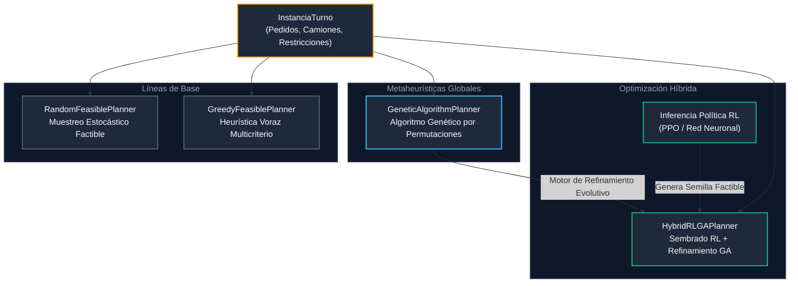
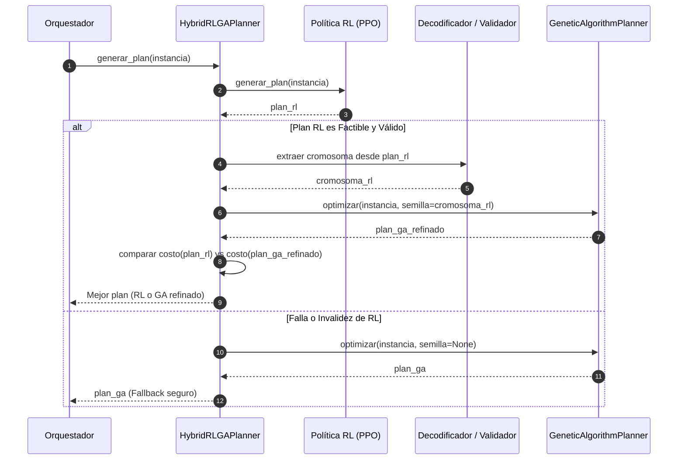

# Algoritmos de Planificación de Turnos

Este paquete reúne los motores de optimización combinatorial para la asignación y secuenciamiento de viajes de despacho a la flota de camiones.

Todos los algoritmos implementan el protocolo común `planner.core.base.PlanificadorTurno`, asegurando que cualquier solución respete rigurosamente las restricciones operativas duras del dominio (capacidad de tolva, descarga obligatoria por volcador y ventanas de turno).

---

## Arquitectura y Relación de Algoritmos

El sistema cuenta con tres niveles de resolución complementarios:

---

## Catálogo de Algoritmos

### 1. `RandomFeasiblePlanner` (Línea de Base Estocástica)
- **Módulo**: `planner.algorithms.random_feasible`
- **Estrategia**: Construcción estocástica basada en muestreo aleatorio uniforme de pedidos pendientes.
- **Funcionamiento**:
  1. Itera sobre los pedidos pendientes en orden barajado según una semilla (`seed`) determinista.
  2. Empaqueta pedidos en viajes respetando la capacidad nominal del camión asignado y segregando pedidos de descarga volcador al final del viaje.
  3. Reparte los viajes entre los camiones disponibles de manera uniforme para balancear salidas sin optimizar tiempos ni distancias.
- **Propósito**: Cota inferior de rendimiento y generador de contraste para contrastar heurísticas avanzadas.

---

### 2. `GreedyFeasiblePlanner` (Heurística Voraz Multicriterio)
- **Módulo**: `planner.algorithms.greedy`
- **Estrategia**: Heurística constructiva determinista guiada por reglas logísticas de despacho.
- **Funcionamiento**:
  1. **Partición de Viajes**:
     - *Pedidos Volcador*: Se aíslan en viajes dedicados exclusivos (`_construir_viajes_volcador`).
     - *Pedidos Estándar*: Se agrupan vorazmente maximizando el factor de llenado de tolva (`_construir_viajes_normales`).
  2. **Priorización de Despacho**:
     - Ordena los viajes mediante un puntaje compuesto por: ventana horaria prometida al cliente (urgencia temporal), prioridad del cliente y distancia al destino.
  3. **Asignación a Flota**:
     - Asigna el viaje con mayor prioridad al camión que primero quede libre en la planta, minimizando el tiempo ocioso y el *makespan* global.
- **Propósito**: Generación rápida (< 50 ms) de soluciones factibles de alta calidad operativa.

---

### 3. `GeneticAlgorithmPlanner` (Metaheurística Evolutiva)
- **Módulo**: `planner.algorithms.ga`
- **Estrategia**: Búsqueda global estocástica sobre un espacio de permutaciones mediante operadores genéticos adaptativos.

#### Parámetros de Control (`ConfiguracionGA`)
- `tamano_poblacion`: Número de individuos (cromosomas) por generación.
- `generaciones`: Límite máximo de iteraciones evolutivas.
- `tamano_elite`: Cantidad de mejores soluciones preservadas intactas generación a generación.
- `tamano_torneo`: Número de candidatos seleccionados aleatoriamente para competir en cada torneo de selección de padres.
- `probabilidad_crossover`: Tasa de aplicación del operador de cruce OX frente a clonación directa.
- `probabilidad_mutacion_swap`: Probabilidad de permutar dos pedidos en el cromosoma.
- `probabilidad_mutacion_inversion`: Probabilidad de invertir el orden de un segmento contiguo de pedidos.
- `generaciones_sin_mejora_max`: Paciencia para detención temprana (*early stopping*) si la aptitud se estanca.
- `tolerancia_mejora`: Umbral mínimo de reducción de costo para considerar que hubo avance.

#### Composición del Cromosoma
- **Estructura**: Un cromosoma es una tupla ordenada de números enteros:
  $$\text{Cromosoma} = (p_0, p_1, p_2, \dots, p_{N-1})$$
  donde cada gen $p_i$ representa el índice de un pedido base tras el preprocesamiento y partición por capacidad (*order split*).
- **Invariante de Factibilidad**: Todo cromosoma es una biyección estricta (permutación sin repeticiones ni omisiones) del conjunto de pedidos $\{0, 1, \dots, N-1\}$.
- **Decodificación**: El decodificador determinista (`decodificar_plan_permutacion`) mapea el cromosoma a una asignación física concreta de viajes, camiones y horarios respetando capacidades y restricciones de descarga.

#### Operadores Genéticos
1. **Selección por Torneo (`_seleccion_torneo`)**: Se eligen aleatoriamente $k$ individuos de la población y el que posea el menor costo multiobjetivo es seleccionado como progenitor.
2. **Cruce Ordenado OX (`_crossover_ordenado` / Order Crossover)**: Extrae un segmento del Progenitor 1 preservando su orden y posición, y completa las posiciones restantes con los genes del Progenitor 2 en orden de aparición, garantizando siempre permutaciones válidas sin duplicados.
3. **Mutación Swap (`_mutar`)**: Selecciona dos posiciones al azar en la permutación e intercambia sus índices. Permite explorar pequeñas variantes de secuencia.
4. **Mutación por Inversión (`_mutar`)**: Invierte el orden de los genes en un subsegmento continuo $[i, j]$. Permite reordenar bloques de pedidos eficientemente.
5. **Elitismo**: Los mejores individuos pasan intactos a la siguiente generación, garantizando que el mejor costo histórico nunca empeore.
6. **Inyección de Semillas (*Warm-Start*)**: Acepta soluciones conocidas (e.g. Greedy o inferencia RL) y genera variantes mutadas controladas para enriquecer la población inicial.

---

### 4. `HybridRLGAPlanner` (Optimizador Híbrido RL $\to$ GA)
- **Módulo**: `planner.algorithms.hybrid_rl_ga`
- **Estrategia**: Arquitectura secuencial donde una política de Aprendizaje por Refuerzo (RL) actúa como generador de semilla y el Algoritmo Genético (GA) realiza una búsqueda local y refinamiento evolutivo.

#### Flujo de Ejecución del Híbrido

- **Criterio de Decisión (`DecisionHibridaRLGA`)**:
  - `REFINADO_GA`: Si el GA refinado reduce el costo de la solución de RL por encima de `tolerancia_mejora`, se adopta el plan refinado.
  - `SEMILLA_RL`: Si el GA no logra mejorar el costo o se estanca, se mantiene la solución directa del modelo neuronal.
  - `FALLBACK_GA_PURO`: Si el modelo de RL falla o genera una solución infactible, el algoritmo recurre de forma segura a una ejecución pura del GA.
